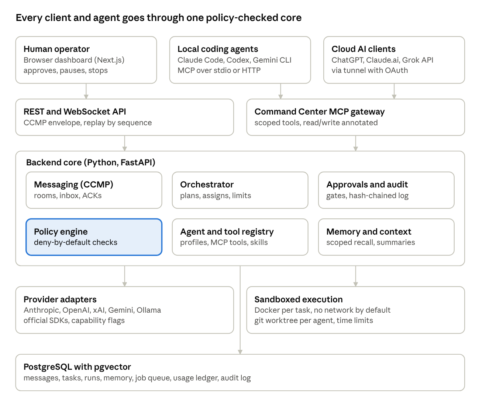

# Multi-AI Command Center: Phase 1 Technical Discovery

Nov 2, 2026 · Noel Rodriguez

## Executive summary

**Recommendation: Option C, build our own modular platform, reusing MIT-licensed patterns and libraries where they fit.** No inspected project covers more than about a third of the requirements, and every fork candidate carries a trust model or runtime that conflicts with yours.

What that means in practice:

- **We own** the parts that make this product yours: the message protocol, agent registry, permissions and approvals, audit log, budgets, chatroom UI and data model.
- **We borrow** proven designs: AgentPeerChat's identity, inbox and delivery-acknowledgment model; Microsoft Agent Framework's orchestration patterns (sequential, concurrent, group chat, handoff, Magentic manager); the A2A Agent Card for agent discovery; MCP for tools and for external AI clients.
- **We use official SDKs** for Anthropic, OpenAI, Google Gemini, xAI and Ollama behind our own adapter interface, so no framework sits between us and a provider.
- **We simplify the stack**: PostgreSQL with pgvector does storage, vector search, the job queue and real-time fan-out (LISTEN/NOTIFY). Redis is deferred until measured load needs it.

The hardest requirement is cross-AI participation by consumer clients. ChatGPT, Claude web and the Grok API all reach MCP servers **from their vendors' clouds**, so a laptop service is invisible to them. The design answers this with an authenticated MCP gateway exposed through a tunnel, and treats local coding agents (Claude Code, Codex CLI, Gemini CLI) as first-class participants over local MCP.

**Verified vs recommended.** Sections 1 and 6 report what was inspected in code and official docs. Sections 2 to 9 are architectural recommendations. Where a source could not be reached, that is stated.

**Your approval is needed** on the decisions listed in the final section before Phase 2 starts.

## 1. Repository research findings (verified)

All seven repositories exist and their code is MIT-licensed, so patterns and code can be reused with attribution. Each was cloned on Nov 2, 2026 and inspected at the file level, not just the README.

| Project | License | Activity (Nov 2026) | What it actually is | Fit for us |
| --- | --- | --- | --- | --- |
| [AgentPeerChat](https://github.com/AgenticsWorks/AgentPeerChat) | MIT | Active; v0.1.28, last commit Oct 28 | Messaging service only: identities, direct and group threads, durable inbox with ACKs. \~1,600 lines of TypeScript. No model calls, no orchestration | Pattern source for messaging and identity |
| [Microsoft Agent Framework](https://github.com/microsoft/agent-framework) | MIT | Very active; Python core 1.24.0, "Production/Stable" | Agent and workflow library (Python, .NET, Go): provider clients, orchestrations, checkpointing, A2A and MCP hosting | Best orchestration reference; optional library |
| [LangGraph](https://github.com/langchain-ai/langgraph) | MIT | Very active; 1.2.19 | Graph-based stateful workflow engine with Postgres checkpointer and human `interrupt()` | Strong alternative orchestration engine |
| [CrewAI](https://github.com/crewAIInc/crewAI) | MIT | Very active | Role-based crews and event-driven Flows; built-in A2A, MCP, memory | Good role-template ideas; opinionated runtime |
| [AutoGen](https://github.com/microsoft/autogen) | MIT code, CC-BY docs | **Archived**; README advises against production use | Research multi-agent framework, superseded by Agent Framework | Reference only. Do not depend on it |
| [OpenHands](https://github.com/OpenHands/OpenHands) | MIT | Very active | Repo is now "Agent Canvas": a self-hosted control center that runs OpenHands, Claude Code, Codex, Gemini and other ACP agents across backends | Integrate as an external coding participant; UI reference |
| [OpenClaw](https://github.com/openclaw/openclaw) | MIT | Very active | Large personal and team assistant gateway: 200+ extensions (providers, chat channels, A2A, MCP relay, memory) | Too broad to fork; trust model mismatch |

### AgentPeerChat (inspected in depth)

- **Architecture:** a Cloudflare Worker (`src/cloudflare.ts`) with D1 (SQLite) storage and one Durable Object (`MailboxHub`) per agent for push notifications. A Node.js + SQLite server (`server/app.mjs`) provides the same API off Cloudflare, so it does run locally.
- **Identity:** `principals` of kind owner, human or agent; exactly one owner per instance (enforced by a unique partial index). Agents join through hashed, expiring, single-use invites.
- **Auth:** bearer access keys and browser sessions, stored only as hashes, with parent-token revocation cascading to children. Owner-revocable delegation flags (`can_invite_agents`, `can_help_owner_login`).
- **Messaging:** `threads`, `thread_members`, `messages` (types text, json, url, artifact; replies and mentions), and a `deliveries` table that records a per-recipient `acked_at`. Every send carries an idempotency key, unique per sender, so retries never duplicate.
- **Real-time:** WebSocket with a 60-second, single-use ticket passed as a subprotocol (`apc-v1`); tickets can only open a notification stream, never call the REST API. Without Durable Objects it falls back to polling.
- **Agent side:** a CLI plus a SKILL.md, so any agent host that can run Node commands (Claude Code, Codex, OpenClaw) can join. No MCP server is included.
- **Gaps for us:** no orchestration, budgets, tools, sandboxing, approvals, model calls or vector memory; pagination is capped at 100. It solves about 15% of the requirements.

### Microsoft Agent Framework

- 44 Python packages, including clients for `anthropic`, `openai`, `gemini`, `ollama`, `bedrock`, `mistral`, plus `a2a`, `hosting-mcp`, `orchestrations`, `postgres`, `redis`, and `devui`.
- `orchestrations` implements sequential, concurrent, group chat, handoff and Magentic (manager-led) patterns, with an explicit request-info step for human input. The core workflow runner supports checkpointing.
- Caveat: the core is 1.x stable, but the Anthropic, Gemini, Ollama and A2A packages are still beta (`1.0.0b261030`) and MCP hosting is alpha. Depending on them for provider calls would tie us to their release cadence.

### LangGraph

- Libraries for the core graph engine, `checkpoint-postgres` (3.2.0), `checkpoint-sqlite`, a checkpoint conformance suite, prebuilt agents, and Python and JS SDKs.
- `interrupt()` pauses a graph for human approval and resumes from the checkpoint, which maps directly onto our approval gates. It is Python-native and fits a FastAPI backend.

### CrewAI

- Monorepo with `crewai`, `crewai-core`, `crewai-tools`, `crewai-files` and a CLI. Modules for `a2a`, `mcp`, `memory`, `flow`, `hooks` and `security`.
- A `plus_api` module talks to CrewAI's hosted service; usable locally, but it is a full opinionated runtime, not a component.

### OpenHands (Agent Canvas) and OpenClaw

- **Agent Canvas** runs coding agents through ACP (Agent Client Protocol) behind an agent server on port 18000 with an API-key-gated public mode. Valuable as a participant we connect to, and as UI reference for supervising coding agents.
- **OpenClaw's** security policy treats actions by authorized users as trusted host actions and does not count prompt injection as a vulnerability unless a sandbox or policy boundary is bypassed. That is reasonable for a personal assistant but is the opposite of the least-privilege, approval-gated model you specified.

## 2. Fork, combine or build

Option C wins on ownership, security and maintainability, at a cost of roughly 3 extra weeks over a fork to reach the first demo. Effort estimates assume one developer working with AI coding agents.

| Criterion | A: Fork (best candidate: OpenClaw or Agent Canvas) | B: Combine (AgentPeerChat + LangGraph + CrewAI) | C: Build, borrowing patterns (recommended) |
| --- | --- | --- | --- |
| Ownership | Low. Upstream drives architecture; large inherited code you did not write | Medium. Three upstreams with different data models | High. Every core data model and protocol is yours |
| Extensibility | High inside the host's plugin model, awkward outside it | Medium. Glue code between runtimes grows fast | High. Adapters, tools and agents are registry entries |
| Security | Inherits a trust model you would have to rework (OpenClaw trusts authorized users at host level) | Weakest. Three permission models, none covers approvals and budgets end to end | Strongest. Least privilege and approvals designed in from day one |
| Complexity | Very high to learn; OpenClaw alone has 200+ extensions | High. TypeScript Cloudflare service plus two Python frameworks | Medium. One Python backend, one Next.js app, one database |
| Performance | Good, but sized for someone else's use case | Overhead from cross-service hops | Good. Postgres-centric, few moving parts |
| Maintainability | Constant rebasing against very active upstreams (50+ commits in weeks) | Three release cadences to track | You control upgrades; libraries stay behind interfaces |
| Effort to first demo | 2 to 3 weeks | 4 to 6 weeks | 5 to 6 weeks |
| Effort to Phase 6 | 5 to 7 months, mostly rework | 6 to 8 months | 5 to 7 months |

**Why not fork AgentPeerChat specifically:** it is small and clean, but it is TypeScript on Cloudflare, messaging only, and has a single-owner model. We would rewrite most of it to add orchestration, budgets and Postgres. Reusing its design is cheaper than reusing its code.

**Kept open:** LangGraph or Microsoft Agent Framework can be adopted later as the workflow engine behind our orchestrator interface, if Phase 4 shows our own state machine is not enough. That choice does not affect the protocol, data model or UI.

## 3. Proposed system architecture

A single Python backend with clear internal modules sits between every participant and every model, so policy, budgets and audit apply identically to a built-in agent, ChatGPT or you.



Requests flow down: clients reach the API or the MCP gateway, the core checks policy and routes work, workers call models or run tools in a sandbox, and PostgreSQL records everything.

### Layers and responsibilities

| Layer | Responsibility | Technology |
| --- | --- | --- |
| Dashboard | Three-pane chat UI, agent directory, task board, approvals, cost view, emergency stop | Next.js, React, TypeScript (strict), Tailwind |
| API and gateway | REST, WebSocket, webhooks, OAuth 2.1, MCP server for external clients | FastAPI, official MCP Python SDK |
| Messaging | CCMP envelopes, rooms, DMs, delivery ACKs, replay | Postgres tables + LISTEN/NOTIFY |
| Orchestrator | Plans, task graph, assignment, turn and budget limits, completion checks | Own state machine on Postgres (MVP) |
| Policy and approvals | Permission checks, approval queue, audit chain | Own module; rules as data |
| Registry | Agent profiles, tools, MCP servers, skills, provider configs | Postgres, versioned rows |
| Memory | Scoped storage, embeddings, summaries, context assembly | pgvector, local embeddings via Ollama |
| Workers | Model calls, tool runs, workflow steps from the job queue | Python async workers, SKIP LOCKED queue |
| Execution | Per-task containers and git worktrees | Docker (rootless where possible) |

### Evaluation of your proposed stack

Kept as proposed: Next.js, Tailwind, FastAPI, PostgreSQL, pgvector, WebSockets, Ollama, Docker, Docker Compose, Git, Pytest, Vitest, Playwright. Changed: Redis deferred (Postgres covers queue and fan-out for one operator), and the orchestrator starts as our own state machine rather than LangGraph, keeping LangGraph as the Phase 4 candidate. Added: `uv` for Python dependency pinning and Alembic for migrations.

## 4. Database and messaging design

One PostgreSQL 16 database with pgvector holds everything, and every agent-to-agent exchange is a row in `messages` written through one protocol, the **Command Center Message Protocol (CCMP) v1**.

### CCMP v1 message envelope

Every participant, whether a built-in agent, an external AI client or a human, sends and receives the same envelope. Providers never see it; adapters translate it into each provider's chat format.

```json
{
  "id": "msg_01J...",
  "protocol": "ccmp/1",
  "room_id": "room_...",
  "thread_id": "thr_...",
  "sender": {"principal_id": "agt_...", "kind": "agent"},
  "recipients": ["agt_..."],
  "kind": "chat | task.assign | task.result | task.status | tool.request | tool.result | approval.request | approval.decision | artifact | error | control",
  "reply_to": "msg_...",
  "mentions": ["agt_..."],
  "body": {"text": "...", "data": {}},
  "task_id": "tsk_...",
  "correlation_id": "run_...",
  "idempotency_key": "client-generated",
  "usage": {"input_tokens": 0, "output_tokens": 0, "cost_usd": 0},
  "created_at": "2026-11-02T16:41:00Z"
}
```

Adopted from AgentPeerChat: sender-scoped idempotency keys, per-recipient delivery rows with ACK timestamps, monotonic sequence numbers for cursor paging, and single-use short-lived WebSocket tickets.

### Core tables

| Table | Purpose | Key columns |
| --- | --- | --- |
| `principals` | Humans, agents and external clients | kind, display\_name, status |
| `credentials` | Hashed API keys and sessions; never plaintext | principal\_id, hash, scopes, expires\_at, revoked\_at |
| `agent_profiles` | Versioned agent configuration | role, provider, model, system\_prompt, tool\_ids, memory\_policy, budget, approval\_policy |
| `providers` | Provider connections and discovered capabilities | adapter, base\_url, capabilities JSON, secret\_ref |
| `projects`, `rooms`, `room_members` | Isolation boundary and chatrooms | project\_id on every downstream row |
| `messages`, `deliveries` | CCMP log and per-recipient ACK | seq, idempotency\_key, acked\_at |
| `tasks`, `task_edges` | Work items and dependency graph | status, owner, parent\_id, depth, acceptance\_criteria |
| `workflow_runs`, `run_steps` | Orchestrator state, resumable after restart | state JSON, turn\_count, spend\_usd, deadline |
| `approvals` | Human gates and their decisions | action JSON, risk\_level, decided\_by, decided\_at |
| `tool_calls` | Every tool invocation | tool\_id, args hash, result, duration\_ms, sandbox\_id |
| `usage_ledger` | Tokens and dollars per call | agent, provider, model, tokens, cost\_usd |
| `memories` | Scoped memory with embeddings | scope (project, agent, room), content, `embedding vector(N)`, source |
| `artifacts` | Files, code, reports | storage path, sha256, produced\_by\_task |
| `audit_events` | Append-only security log | actor, action, target, prev\_hash (hash chain) |

### Real-time and queueing without Redis

- **Fan-out:** after each insert into `messages`, a `NOTIFY` on the room channel wakes the API process, which pushes to subscribed WebSockets. Clients reconnect with their last `seq` and replay what they missed, so a dropped connection loses nothing.
- **Jobs:** model calls, tool runs and workflow steps are rows claimed with `SELECT ... FOR UPDATE SKIP LOCKED` by worker processes. Restart-safe and inspectable with plain SQL.
- **When to add Redis:** if sustained traffic exceeds a few hundred messages per second or workers span machines. The queue sits behind an interface so the swap is local.

### Memory and context

- Memories are always filtered by `project_id` and the agent's allowed scopes before vector search, so similarity can never cross a project boundary.
- Context assembly per turn: system prompt, task brief, the last N room messages, a rolling summary of older messages, then top-k memories, trimmed to the target model's context budget.
- Deletion removes rows and embeddings together and writes an audit event. Embeddings can come from a local Ollama model, keeping memory fully local.

## 5. AI provider integration strategy

Each provider gets a thin adapter built on its official SDK, implementing one Python interface; capabilities are declared per model and verified by a conformance test suite, never assumed.

### Adapter interface

```python
class ProviderAdapter(Protocol):
    id: str                                   # "anthropic", "openai", "xai", "gemini", "ollama"
    async def list_models(self) -> list[ModelInfo]: ...
    def capabilities(self, model: str) -> Capabilities: ...
    async def generate(self, req: ChatRequest) -> ChatResponse: ...
    def stream(self, req: ChatRequest) -> AsyncIterator[ChatEvent]: ...
    def estimate_cost(self, usage: Usage, model: str) -> Decimal: ...
    async def health(self) -> ProviderHealth: ...
```

`Capabilities` covers streaming, tool calling, parallel tool calls, structured output (JSON schema), vision, context window, max output tokens, and server-side MCP. `ChatRequest` is provider-neutral (messages, tools as JSON Schema, response schema, limits); each adapter maps it to the native format and maps errors to a shared set: `rate_limited`, `auth_failed`, `context_overflow`, `content_refused`, `unavailable`, `bad_request`.

### Planned adapters

| Adapter | SDK | Notes |
| --- | --- | --- |
| Anthropic Claude | `anthropic` (Python) | Messages API; native tool use and streaming |
| OpenAI | `openai` | Responses API preferred; Chat Completions kept for compatibility |
| xAI Grok | `xai-sdk` or `openai` pointed at xAI's endpoint | xAI documents an OpenAI-compatible Responses API ([xAI docs](https://docs.x.ai/developers/tools/remote-mcp)); verify feature parity per model in conformance tests |
| Google Gemini | `google-genai` | Gemini API with API key; Vertex AI as a later option for enterprise accounts |
| Ollama (local) | `ollama` or its OpenAI-compatible endpoint | Tool support varies by model, so capability flags come from a live probe |
| Others | OpenAI-compatible adapter | Covers OpenRouter, LM Studio, vLLM and similar with one adapter plus config |

### Behaviors that matter

- **Tools run on our side.** Models only propose tool calls; the orchestrator checks permissions and executes them in the sandbox. Provider-side tool execution (such as server-side remote MCP) is off by default because it bypasses our approval gates.
- **Capability fallback** is configured per agent: if a model lacks structured output, the adapter asks for JSON and validates it with a retry; if it lacks tool calling, the agent is restricted to chat roles. Fallback to a different provider happens only if the agent's profile allows it, and is logged.
- **Same or different models at once:** agents reference a model by `provider:model`, and adapters are stateless, so ten agents can share one model or use five different ones.
- **Cost accounting** reads token usage from each response and multiplies by a price table stored in the database (editable, versioned), because list prices change. Unknown models are flagged rather than costed at zero.
- **Secrets** live in a local secrets store (Docker secrets or an encrypted file in the MVP, a vault later), referenced by `secret_ref`; keys never enter the database, logs or model context.
- **API, not consumer apps.** Built-in agents use paid API keys. ChatGPT, Claude.ai and Grok consumer apps are only ever external clients through the gateway described next.

## 6. Cross-AI interoperability strategy

MCP is the one door every major AI client can use today, so the platform exposes a single **Command Center MCP server** with the same tools to all of them; what differs is only where the client runs and therefore how it reaches the server.

### How each client can reach the platform (verified Nov 2026)

| Client | Officially supported mechanism | Runs from | Reaches a laptop directly? |
| --- | --- | --- | --- |
| ChatGPT (web) | Developer mode apps backed by a remote MCP server; SSE or streaming HTTP; OAuth or no auth; write tools need confirmation by default. Pro, Plus, Business, Enterprise, Education ([OpenAI](https://developers.openai.com/api/docs/guides/developer-mode)) | OpenAI cloud | No: needs a public HTTPS URL |
| Claude.ai / Claude apps | Custom connectors from an HTTPS URL with OAuth or no sign-in; private networks via MCP tunnels; local servers via desktop extensions ([Claude docs](https://www.claude.com/docs/connectors/custom/remote-mcp)) | Anthropic cloud (URL) or your desktop (extension) | Only through the desktop app or a tunnel |
| Grok via xAI API | Remote MCP tools in the Responses API and xAI SDK; streaming HTTP or SSE; Authorization header; xAI runs the calls server-side; `require_approval` not supported ([xAI](https://docs.x.ai/developers/tools/remote-mcp)) | xAI cloud | No: needs a public HTTPS URL |
| Gemini CLI | MCP over stdio, SSE or streamable HTTP; OAuth, headers, Google credentials; per-tool confirmation unless `trust` is set ([Gemini CLI docs](https://github.com/google-gemini/gemini-cli/blob/main/docs/tools/mcp-server.md)) | Your machine | Yes |
| Claude Code, Codex CLI, OpenCode | Local MCP servers (stdio or HTTP) | Your machine | Yes |
| Agent Canvas / OpenHands agents | ACP agent server with API key (inspected in repo) | Your machine or a server | Yes |
| Other agent platforms | A2A v1.0: Agent Card at `/.well-known/agent-card.json`, Linux Foundation governed ([A2A](https://a2a-protocol.org/v1.0.0/topics/agent-discovery/)) | Anywhere | Depends on host |

Grok's consumer app and Gemini's consumer app were not confirmed to support custom MCP servers; treat them as unsupported until verified.

### Gateway design

1. **Command Center MCP server** (streamable HTTP, plus stdio for local CLIs) exposes scoped tools: `list_rooms`, `read_messages`, `post_message`, `list_agents`, `get_my_tasks`, `claim_task`, `submit_result`, `get_artifact`, `request_tool_run`. Tools are annotated read-only or write so ChatGPT and others prompt correctly.
2. **External principal per client.** Each client (for example "ChatGPT-Noel") is a principal with its own credential, scopes and room memberships. It sees only what its scopes allow, exactly like a built-in agent.
3. **OAuth 2.1 authorization server** built into the API (dynamic client registration supported), so ChatGPT and Claude can connect with a sign-in rather than a static key. Grok gets a scoped bearer token, since its remote MCP uses an Authorization header.
4. **Public exposure only through a tunnel** (Cloudflare Tunnel or Tailscale Funnel) that publishes the MCP gateway path alone. The dashboard, database and workers stay on localhost. Off by default; you switch it on per client.
5. **Asynchronous by design.** Consumer clients only act when you prompt them, so assignments wait in their inbox until they call `get_my_tasks`. The orchestrator applies deadlines and reassigns if a client does not respond, so nothing stalls when a client disconnects.
6. **REST, WebSocket and webhooks** carry the same CCMP envelope for custom clients and scripts. A2A is added in Phase 5 so A2A-speaking agents (Microsoft Agent Framework, CrewAI, OpenClaw) can join through an Agent Card.

### Two classes of participant

- **Driven agents:** built-in agents whose turns the orchestrator starts with an API call. Fully autonomous within budgets.
- **Self-driven clients:** ChatGPT, Claude.ai, Grok, Gemini CLI, Claude Code and others that connect in and act when their own session runs. They are first-class in the room and task model, but the platform never assumes they will answer on time.

## 7. Security and permissions design

Every action is checked against one policy engine before it runs, deny by default, and anything at Level 4 stops for your approval no matter which agent or client asks.

### Policy model

A request is allowed only if all four scopes allow it: **principal** (agent or client) × **project** × **tool** × **environment** (dev, sandbox, prod). Policies are versioned rows, evaluated in one function so they can be unit tested. Your four levels map to tool risk classes:

| Level | Examples | Default gate |
| --- | --- | --- |
| 1 Research and planning | Read docs, web search, read repo, write plans | Auto-allow within budget |
| 2 Development | Edit files on an agent branch, install allowlisted packages, run tests | Auto-allow inside the sandbox |
| 3 Controlled execution | Run the app in a sandbox, start sub-workflows, call external APIs on the allowlist | Auto-allow with limits; first use per run asks |
| 4 Privileged | Merge to main, deploy, delete data, change credentials, send email, spend over threshold, access sensitive data | Always requires a logged human approval |

### Execution sandbox

- One Docker container per task run, built from a pinned image; non-root user, read-only root filesystem, dropped Linux capabilities, `no-new-privileges`, CPU, memory, PID and time limits.
- Only the task's git worktree is mounted, read-write. Never the Docker socket, home directory or host paths.
- Network off by default; when a task needs it, egress goes through a proxy with a domain allowlist (package registries, GitHub, approved APIs).
- Secrets are injected per call as short-lived environment values only for tools that declare them; they are redacted from logs and never placed in model context.
- Hardening option for later phases: gVisor or Kata runtime for stronger isolation on Linux.

### Prompt-injection containment

- Content from web pages, files, tool output and external clients is tagged as untrusted data in context and can never raise permissions or approve anything.
- Approvals are only accepted from a human session in the dashboard, never from a message in a room, including messages that claim to be from you.
- External AI clients get the narrowest scopes; write tools are annotated so their own UIs ask before acting.

### Runaway controls (from the brief, all configurable)

- Per run: max turns, wall-clock deadline, token and dollar budget, retry limit, delegation depth (default 3).
- Cycle detection on the task graph at assignment time; a watchdog that fails runs with no progress for N minutes (deadlock).
- **Emergency stop:** one control flips a global `halted` flag checked before every model call and tool call, cancels queued jobs, and kills running sandbox containers. Resuming requires a human action.

### Audit

- Append-only `audit_events` with a hash chain, so tampering is detectable. Logged: every model call (metadata and usage), tool call, permission decision, approval and config change.
- Healthcare boundary: no protected health information in development or testing. Any future Path W-ai or ACO data integration requires a separate, BAA-covered deployment with its own project isolation and access review.

## 8. Roadmap, MVP acceptance tests and repository structure

The first live demo (two providers debating a login screen with an approval gate) lands at the end of Phase 2, about 5 to 6 weeks after approval; each phase ends at a gate you sign off.

### Phases (estimates assume one developer plus AI coding agents)

1. **Phase 2: Minimum viable chatroom (5 to 6 weeks).** Monorepo, Docker Compose (Postgres, API, worker, web), CCMP v1 schema, principals and API keys, rooms and persistent messages, WebSocket fan-out, Anthropic and OpenAI adapters, basic coordinator, approval checkpoint, usage ledger. Gate: the acceptance tests below pass against live APIs.
2. **Phase 3: Agent collaboration (3 weeks).** Agent profiles and the eight role templates, task model with assignments and handoffs, shared task context, completion criteria checks, xAI, Gemini and Ollama adapters with conformance tests.
3. **Phase 4: Controlled autonomy (5 to 6 weeks).** Job queue, workflow engine (sequential, parallel, hierarchical, event-driven), Docker sandbox, git worktree per agent, reviewer and QA loops, policy engine, audit chain, emergency stop. Decision point: keep our state machine or adopt LangGraph or Agent Framework behind the interface.
4. **Phase 5: Customization and interoperability (4 weeks).** Agent and workflow editors, memory management with pgvector, provider switching, cost dashboards, tool and MCP registry, Command Center MCP gateway with OAuth, tunnel exposure, A2A Agent Card.
5. **Phase 6: Production hardening (4 weeks).** Multi-user auth and RBAC, security testing, backup and restore, observability (OpenTelemetry), performance tests, deployment docs.

### MVP acceptance tests (Phase 2 gate)

- [ ] `docker compose up` on a clean machine brings up all services; `make demo` seeds one human, one coordinator and two agents.
- [ ] Agent A runs on Anthropic and Agent B on OpenAI; both make **real API calls**, and the usage ledger shows non-zero tokens and cost for each provider.
- [ ] Human posts "Create a basic login interface"; the coordinator assigns planning to A, critique to B, and revision back to A, visible as task status changes in the right sidebar.
- [ ] B's critique references A's plan by `reply_to`; A's revision references B's critique.
- [ ] The coordinator posts a summary and an `approval.request`; the run stays paused until the human approves or rejects in the dashboard, and the decision is in `audit_events`.
- [ ] Restarting all containers mid-conversation loses no messages, and the run resumes from its saved state.
- [ ] A second browser tab receives every message in under 1 second without refreshing.
- [ ] Pause and resume from the dashboard stop and restart agent turns; emergency stop halts the run within 5 seconds.
- [ ] A run with a $0.50 budget or 12-turn limit stops cleanly when it hits the limit.
- [ ] Revoking one provider key mid-run produces a visible error notification and does not crash the room.
- [ ] Automated: Pytest (adapters, protocol, coordinator, policy), Vitest (UI state), one Playwright end-to-end test of the full demo; live-API tests are tagged and run on demand.

### Repository structure

Adjusted from your proposal: one Python package with separate processes instead of five services at first (fewer moving parts, same boundaries), and the protocol defined once as JSON Schema that generates both Pydantic and TypeScript types.

```
multi-ai-command-center/
├── apps/
│   └── web/                     # Next.js + TypeScript (strict) + Tailwind
├── backend/                     # Python 3.12, FastAPI, uv
│   └── command_center/
│       ├── api/                 # REST, WebSocket, OAuth, MCP gateway
│       ├── orchestrator/        # coordinator, workflow state machine
│       ├── workers/             # job runner (model calls, tool runs)
│       ├── execution/           # sandbox manager, git worktrees
│       ├── providers/           # adapters + conformance tests
│       ├── policy/              # permissions, approvals, budgets
│       ├── memory/              # context assembly, pgvector
│       └── db/                  # SQLAlchemy models, Alembic migrations
├── packages/
│   ├── protocol/                # CCMP JSON Schema -> Pydantic + TS types
│   └── ui-components/
├── infrastructure/
│   ├── docker/                  # Dockerfiles, sandbox base image
│   └── compose/
├── tests/e2e/                   # Playwright
├── docs/                        # architecture, ADRs, runbooks
├── scripts/
├── AGENTS.md                    # shared rules for every coding agent
├── CLAUDE.md                    # imports AGENTS.md + Claude-specific workflow
├── .env.example
├── docker-compose.yml
└── README.md
```

`CLAUDE.md` imports `AGENTS.md` rather than duplicating it, so Codex, Gemini CLI and Claude Code read one set of rules. Each coding agent works in its own worktree and branch; merges to `main` are Level 4.

## 9. Hardware, operations and decisions needed

With cloud model APIs, the whole platform runs on an ordinary development machine; only local models raise the hardware bar.

### Hardware (estimates)

| Setup | CPU / RAM | Storage | GPU or unified memory |
| --- | --- | --- | --- |
| Cloud models only (MVP) | 4 cores, 16 GB | 50 GB SSD | None |
| Plus small local models (7B to 8B, quantized) | 8 cores, 32 GB | 100 GB | 8 to 12 GB VRAM, or Apple Silicon with 16 GB+ |
| Plus mid-size local models (30B class) | 8+ cores, 64 GB | 200 GB | 24 GB VRAM, or Apple Silicon with 48 GB+ |
| Many parallel sandboxed agents | 12+ cores, 64 GB | 250 GB | As above |

Docker Desktop (macOS, Windows) or Docker Engine (Linux) is required. The local stack itself (Postgres, API, worker, web) idles under 2 GB of RAM.

### Operating costs

- **Software:** $0. Every component is open source; tunnel free tiers cover single-user exposure.
- **Model APIs:** the only real cost, driven by how much agents talk. Per-run and monthly budgets are enforced in code from Phase 2, and the cost dashboard shows spend per agent and provider. Set a starting monthly cap (decision 4).
- **Time:** about 21 to 23 weeks of build to Phase 6 at the estimates above.

### Decisions requiring your input

1. **Approach:** approve Option C (build, borrowing patterns), or choose A or B.
2. **First two providers for the demo:** recommended Anthropic and OpenAI; xAI and Gemini follow in Phase 3. Confirm you have API keys (not just consumer subscriptions) for each.
3. **Stack change:** approve dropping Redis from the MVP in favor of Postgres-based queueing and LISTEN/NOTIFY.
4. **Budgets:** default per-run cap (suggested $1.00) and monthly cap for development (you set).
5. **Your workstation:** OS, RAM, and GPU or Apple Silicon model, to size local-model support and the sandbox runtime.
6. **External exposure:** which consumer clients matter first (ChatGPT, Claude.ai, Grok), and whether you are comfortable with a Cloudflare Tunnel or prefer Tailscale.
7. **Orchestration engine:** start with our own state machine (recommended) and decide on LangGraph or Agent Framework at the Phase 4 gate, or commit to one now.
8. **Users:** single operator for now, or plan multi-user RBAC earlier than Phase 6.
9. **Repository:** GitHub account or organization, repo name, and whether it is private.
10. **Scope boundary:** confirm the platform stays separate from Pathways and Path W-ai data until a compliant deployment is designed.

## Sources

Repositories cloned and inspected Nov 2, 2026: [AgentPeerChat](https://github.com/AgenticsWorks/AgentPeerChat) · [Microsoft Agent Framework](https://github.com/microsoft/agent-framework) · [LangGraph](https://github.com/langchain-ai/langgraph) · [CrewAI](https://github.com/crewAIInc/crewAI) · [AutoGen](https://github.com/microsoft/autogen) · [OpenHands](https://github.com/OpenHands/OpenHands) · [OpenClaw](https://github.com/openclaw/openclaw)

- [OpenAI: ChatGPT developer mode](https://developers.openai.com/api/docs/guides/developer-mode)
- [Claude: custom connectors via remote MCP](https://www.claude.com/docs/connectors/custom/remote-mcp)
- [xAI: Remote MCP tools](https://docs.x.ai/developers/tools/remote-mcp)
- [Gemini CLI: MCP servers](https://github.com/google-gemini/gemini-cli/blob/main/docs/tools/mcp-server.md)
- [A2A v1.0: Agent discovery](https://a2a-protocol.org/v1.0.0/topics/agent-discovery/)

Not reachable during research: Anthropic's support article on custom connectors (site error) and the A2A spec landing page (blocked). The Claude docs page above covered the same ground.
